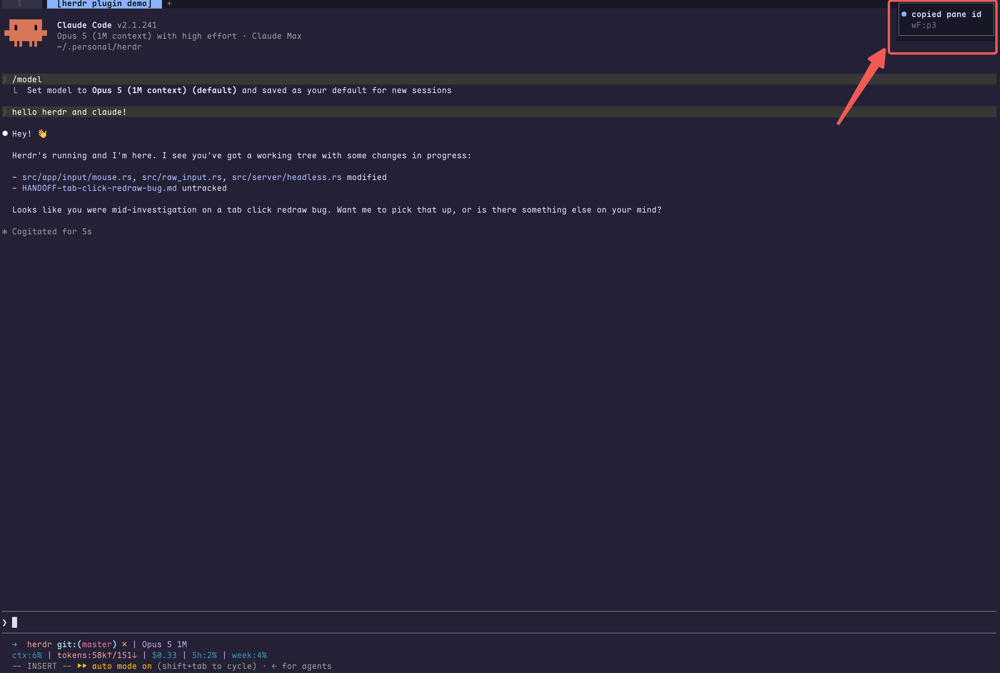
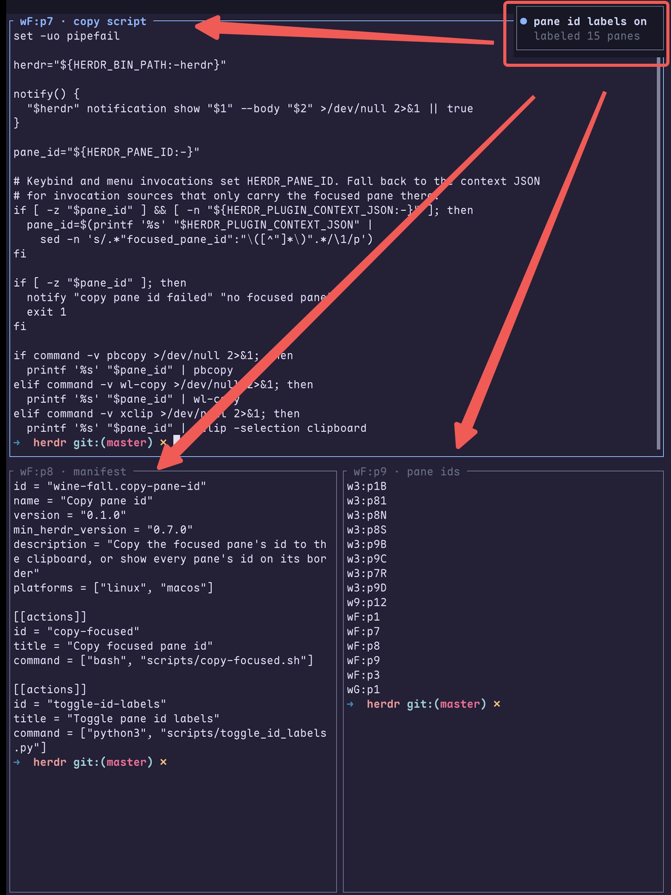

# Copy pane id

A [Herdr](https://herdr.dev) plugin that puts the focused pane's id (`w1:p2`) on
your clipboard with one keypress, and can optionally show every pane's id on its
border.

Pane ids are the only unambiguous handle the Herdr CLI accepts. When you are
driving coding agents across panes, being able to say "read pane `w1:p2`" beats
describing which workspace, tab, and split you meant.



## Install

```bash
herdr plugin install wine-fall/herdr-copy-pane-id
```

Then bind a key in `~/.config/herdr/config.toml`:

```toml
[[keys.command]]
key = "prefix+y"
type = "plugin_action"
command = "wine-fall.copy-pane-id.copy-focused"
description = "copy focused pane id"
```

Add a second binding if you also want the id labels toggle:

```toml
[[keys.command]]
key = "prefix+i"
type = "plugin_action"
command = "wine-fall.copy-pane-id.toggle-id-labels"
description = "toggle pane id labels"
```

Reload with `herdr server reload-config`.

## Actions

| Action | What it does |
| --- | --- |
| `copy-focused` | Copies the focused pane's id to the clipboard and shows a toast. |
| `toggle-id-labels` | Relabels every pane so its id shows on the pane border. Run it again to restore the previous labels. |



`toggle-id-labels` saves the labels it replaces under
`HERDR_PLUGIN_STATE_DIR` and restores them when toggled off, so your own pane
names survive the round trip. A pane that already has a name shows as
`id · name`. Relabeling runs one CLI call per pane, so a toggle over many panes
takes a moment; a second toggle fired while one is still running is refused
rather than interleaved. Renaming a pane by hand while labels are on is undone
when you toggle them off.

## Requirements

- macOS or Linux.
- A clipboard tool: `pbcopy` (macOS), or `wl-copy`, `xclip`, or `xsel` (Linux).
  Without one, `copy-focused` falls back to OSC 52 (see below).
- `python3`, for `toggle-id-labels` only.

## Remote sessions

On a machine with no clipboard tool, typically a headless server you reach over
SSH or as a saved Herdr machine, `copy-focused` writes an OSC 52 sequence into
the focused pane's own terminal. Herdr parses it like any pane output and
forwards the clipboard write to the foreground client, so the id lands on the
clipboard of the machine you are sitting at. Your local terminal emulator must
allow OSC 52 clipboard writes.

Plugin keybindings belong to the machine the plugin runs on: put the
`[[keys.command]]` entries in the remote machine's Herdr config, not your local
one.

## License

MIT
